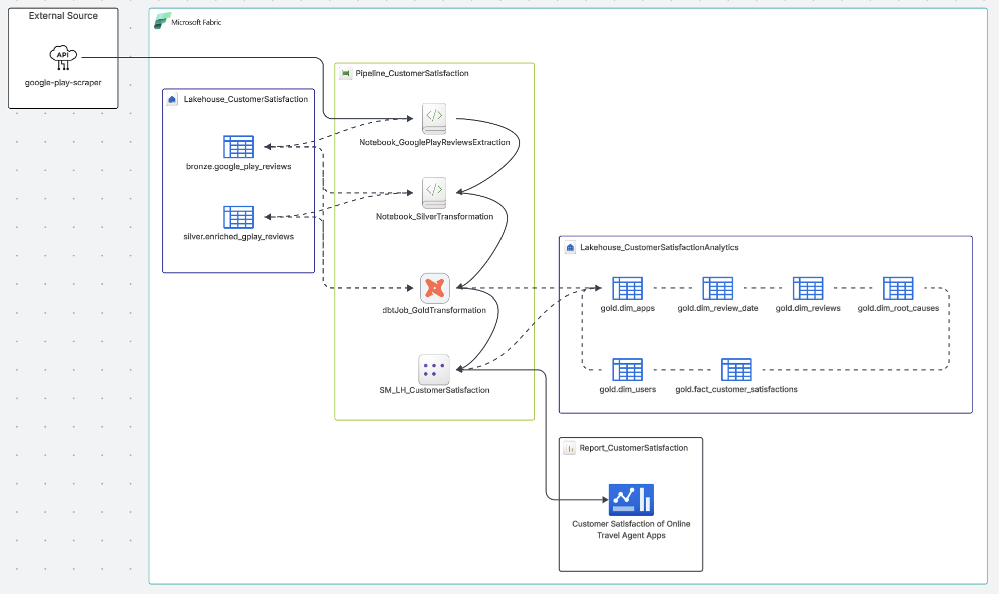
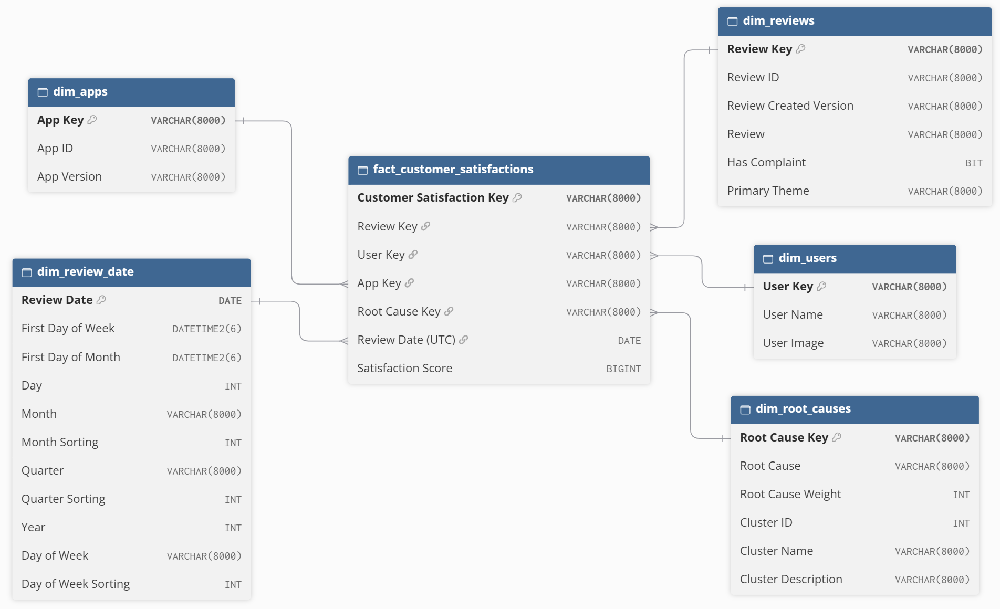
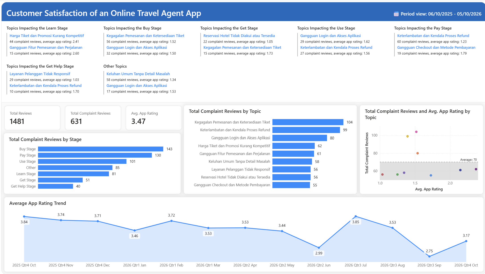
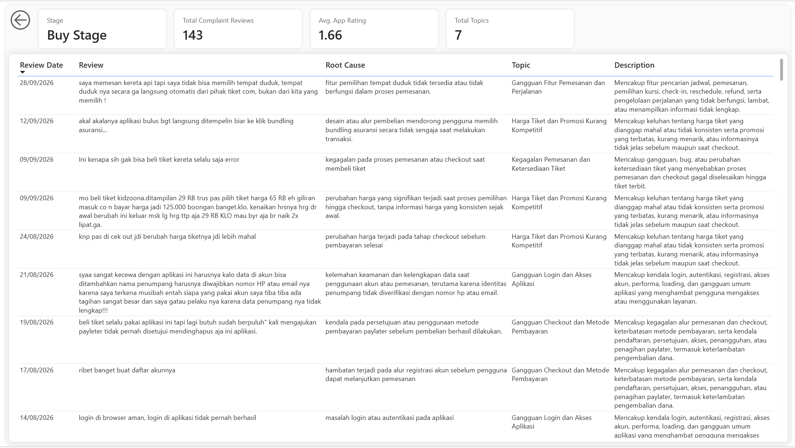

# Customer Satisfaction of an Online Travel Agent App

## 01 Project Objectives
- Masalah: Terdapat keluhan pengguna aplikasi Online Travel Agent (OTA) mengalami hambatan di tiap tahap customer journey dalam aplikasi (Learn, Buy, Get, Use, Pay, Get Help). Namun, keluhan di ulasan app tersebar dan tidak terpetakan per tahap, sehingga perusahan OTA sulit mengetahui di titik mana pengalaman pengguna aplikasi paling mengecewakan.
- Penyelesaian: Pembuatan dashboard proyek ini membantu perusahaan memetakan keluhan pelanggan ke setiap tahap customer journey beserta topiknya, lalu memprioritaskan perbaikan pada tahap dengan keluhan terbanyak dan rating terendah, serta memantau tren rating untuk mengukur hasilnya.
- Tujuan bisnis: Memahami kepuasan pelanggan dengan terukur untuk mendukung keputusan perbaikan berbasis data, demi meningkatkan rating aplikasi dan loyalitas pelanggan.

## 02 Source System
Sumber data yang digunakan berasal dari rating dan ulasan aplikasi OTA di Google Play Store. Pengambilan data ini menggunakan google-play-scraper Python library. Selanjutnya, data disimpan berbentu delta table di Fabric Lakehouse sebagai Bronze layer dalam sebuah alur ELT data. Berikut informasi data tersebut:
- Nama tabel → google_play_reviews
- Deskripsi data → Rating dan ulasan pengguna aplikasi OTA di Google Play Store yang diambil dalam setahun terakhir.
- Bentuk data → Data terstruktur yang telah diekstrak dan dimuat menjadi bentuk delta table dan disimpan dalam skema bronze di Lakehouse_CustomerSatisfaction.
- Pengelompokkan tipe data → Data ini dikelompokkan dalam tiga tipe data: Categorical Data, Date and Time Data, serta Continuous Data untuk konteks dan pengukuran metrik dalam analisis.

## 03 Data Pipeline

## 04 Semantic Model
Berdasarkan data pipeline, hasil akhir alur ELT data adalah data warehouse dengan star schema yang disimpan dalam skema gold di Lakehouse_CUstomerSatisfactionAnalytics. Kemudian, data warehouse yang terdiri dari tabel dimensi dan fakta ini digunakan dengan menggunakan Fabric Semantic Model untuk data modeling. Data modeling yang dilakukan terdiri dari konfigurasi hubungan antara tabel dimensi dengan tabel fakta, pembuatan pengukuran dengan DAX, dan konfigurasi format tampilan data. Hasil data modeling tersimpan di SM_LH_CustomerSatisfaction. Berikut informasi tabel dimensi dan fakta yang digunakan:

- Tabel fact_customer_satisfactions
    - Kolom dan tipe data

        | Nama kolom                | Tipe data     | Pengelompokkan tipe data  |
        |---------------------------|---------------|---------------------------|
        | Customer Satisfaction Key | VARCHAR(8000) | Surrogate key             |
        | Review Key                | VARCHAR(8000) | Foreign key               |
        | User Key                  | VARCHAR(8000) | Foreign key               |
        | App Key                   | VARCHAR(8000) | Foreign key               |
        | Root Cause Key            | VARCHAR(8000) | Foreign key               |
        | Review Date (UTC)         | DATE          | Foreign key               |
        | Satisfaction Score        | BIGINT        | Continuous data/Measure   |
    
    - Kolom referensi

        | Nama kolom referensi  | Tujuan kolom      | Tujuan tabel      |
        |-----------------------|-------------------|-------------------|
        | Review Key            | Review Key        | dim_reviews       |
        | User Key              | User Key          | dim_users         |
        | App Key               | App Key           | dim_apps          |
        | Root Cause Key        | Root Cause Key    | dim_root_causes   |
        | Review Date (UTC)     | Review Date       | dim_review_date   |

- Tabel dim_apps
    - Kolom dan tipe data

        | Nama kolom    | Tipe data     | Pengelompokkan tipe data                          |
        |---------------|---------------|---------------------------------------------------|
        | App Key       | VARCHAR(8000) | Surrogate key                                     |
        | App ID        | VARCHAR(8000) | Natural key/Categorical data/Dimension attribute  |
        | App Version   | VARCHAR(8000) | Categorical data/Dimension attribute              |

- Tabel dim_review_date
    - Kolom dan tipe data

        | Nama kolom            | Tipe data     | Pengelompokkan tipe data                  |
        |-----------------------|---------------|-------------------------------------------|
        | Review Date           | DATE          | Primary key                               |
        | First Day of Week     | DATETIME2(6)  | Date and time data/Dimension attribute    |
        | First Day of Month    | DATETIME2(6)  | Date and time data/Dimension attribute    |
        | Day                   | INT           | Continuous data/Dimension attribute       | 
        | Month                 | VARCHAR(8000) | Categorical data/Dimension attribute      |
        | Month Sorting         | INT           | Continuous data/Dimension attribute       |
        | Quarter               | VARCHAR(8000) | Categorical data/Dimension attribute      |
        | Quarter Sorting       | INT           | Continuous data/Dimension attribute       |
        | Year                  | INT           | Continuous data/Dimension attribute       |
        | Day of Week           | VARCHAR(8000) | Categorical data/Dimension attribute      |
        | Day of Week Sorting   | INT           | Continuous data/Dimension attribute       |

- Tabel dim_reviews
    - Kolom dan tipe data

        | Nama kolom                | Tipe data     | Pengelompokkan tipe data              |
        |---------------------------|---------------|---------------------------------------|
        | Review Key                | VARCHAR(8000) | Surrogate key                         |
        | Review ID                 | VARCHAR(8000) | Categorical data/Dimension attribute  | 
        | Review Created Version    | VARCHAR(8000) | Categorical data/Dimension attribute  | 
        | Review                    | VARCHAR(8000) | Categorical data/Dimension attribute  | 
        | Has Complaint             | BIT           | Categorical data/Dimension attribute  |
        | Primary Theme             | VARCHAR(8000) | Categorical data/Dimension attribute  |

- Tabel dim_root_causes
    - Kolom dan tipe data

        | Nama kolom            | Tipe data     | Pengelompokkan tipe data              |
        |-----------------------|---------------|---------------------------------------|
        | Root Cause Key        | VARCHAR(8000) | Surrogate key                         |
        | Root Cause            | VARCHAR(8000) | Categorical data/Dimension attribute  |
        | Root Cause Weight     | INT           | Continuous data/Dimension attribute   |
        | Cluster ID            | INT           | Continuous data/Dimension attribute   |
        | Cluster Name          | VARCHAR(8000) | Categorical data/Dimension attribute  |
        | Cluster Description   | VARCHAR(8000) | Categorical data/Dimension attribute  |

- Tabel dim_users
    - Kolom dan tipe data

        | Nama kolom    | Tipe data     | Pengelompokkan tipe data              |
        |---------------|---------------|---------------------------------------|
        |User Key       | VARCHAR(8000) | Surrogate key                         |
        |User Name      | VARCHAR(8000) | Categorical data/Dimension attribute  |
        |User Image     | VARCHAR(8000) | Categorical data/Dimension attribute  |

## 05 Data Visualization
Visualisasi data dilakukan menggunakan Fabric Report dengan memanfaatkan Fabric Semantic Model yang telah dibuat sebelumnya. Hasil visualisasi data berupa dashboard yang tersimpan di Report_CustomerSatisfaction. Dashboard ini terdiri dari dua halaman, yaitu sebagai berikut:

### 05-1 Halaman 1 - Main

Halaman ini menampilkan ringkasan rating dan ulasan pengguna aplikasi di Google Play Store dalam periode setahun terakhir (6 Oktober 2025 - 5 Oktober 2026). Berikut penjelasan visualisasi yang ditampilkan pada halaman ini:
- Multi-row cards:
    - Topics Impacting the Learn Stage → Dua topik dengan jumlah ulasan komplain pengguna aplikasi terbanyak terhadap tahapan Learn dalam Customer Journey.
    - Topics Impacting the Buy Stage → Dua topik dengan jumlah ulasan komplain pengguna aplikasi terbanyak terhadap tahapan Buy dalam Customer Journey.
    - Topics Impacting the Get Stage → Dua topik dengan jumlah ulasan komplain pengguna aplikasi terbanyak terhadap tahapan Get dalam Customer Journey.
    - Topics Impacting the Use Stage → Dua topik dengan jumlah ulasan komplain pengguna aplikasi terbanyak terhadap tahapan Use dalam Customer Journey.
    - Topics Impacting the Pay Stage → Dua topik dengan jumlah ulasan komplain pengguna aplikasi terbanyak terhadap tahapan Pay dalam Customer Journey.
    - Topics Impacting the Get Help Stage → Dua topik dengan jumlah ulasan komplain pengguna aplikasi terbanyak terhadap tahapan Get Help dalam Customer Journey.
    - Other Topics → Topik ulasan komplain pengguna aplikasi yang tidak teridentifikasi pada tahapan apapun dalam Customer Journey.

- Cards:
    - Total Reviews → Jumlah ulasan pengguna aplikasi dalam periode.
    - Total Complaint Reviews → Jumlah ulasan komplain pengguna aplikasi dalam periode.
    - Avg. App Rating → Rata-rata rating aplikasi dalam periode.

- Charts:
    - Total Complaint Reviews by Stage → Perbandingan jumlah ulasan komplain pengguna aplikasi antara tahapan dalam periode.
    - Total Complaint Reviews by Topic → Perbandingan jumlah ulasan komplain pengguna aplikasi antara topik dalam periode.
    - Total Complaint Reviews and Avg. App Rating by Topic → Pengelompokkan topik berdasarkan hubungan jumlah ulasan komplain pengguna aplikasi dengan rata-rata rating aplikasi, serta ambang batas rata-rata dari keseluruhan jumlah ulasan komplain pengguna aplikasi dalam periode.
    - Average App Rating Trend → Perkembangan rata-rata rating aplikasi sepanjang bulan dalam periode.

### 05-2 Halaman 2 - Stage

Halaman ini menampilkan rincian ulasan komplain pengguna aplikasi untuk memberikan analsis mendalam pada salah satu tahapan (pada gambar ini menampilkan tahapan Buy) dalam periode yang sama dengan halaman 1. Halaman ini muncul saat melakukan drill through salah satu tahapan yang ditampilkan oleh Total Complaint Reviews by Stage chart di Halaman 1. Berikut penjelasan visualisasi yang ditampilkan pada halaman ini:
- Cards:
    - Stage → Tahapan yang sedang dianalisis mendalam.
    - Total Complaint Reviews → Jumlah ulasan komplain pengguna aplikasi pada tahapan Buy dalam periode.
    - Avg. App Rating → Rata-rata rating aplikasi pada tahapan Buy dalam periode.
    - Total Topics → Jumlah topik terkait tahapan Buy dalam periode.

- Tables:
    - Review Date → Tanggal ulasan komplain pengguna aplikasi dibagikan.
    - Review → Isi ulasan komplain pengguna aplikasi.
    - Root Cause → Akar masalah ulasan komplain pengguna aplikasi.
    - Topik → Topik ulasan komplain pengguna aplikasi.
    - Description → Deskripsi topik.